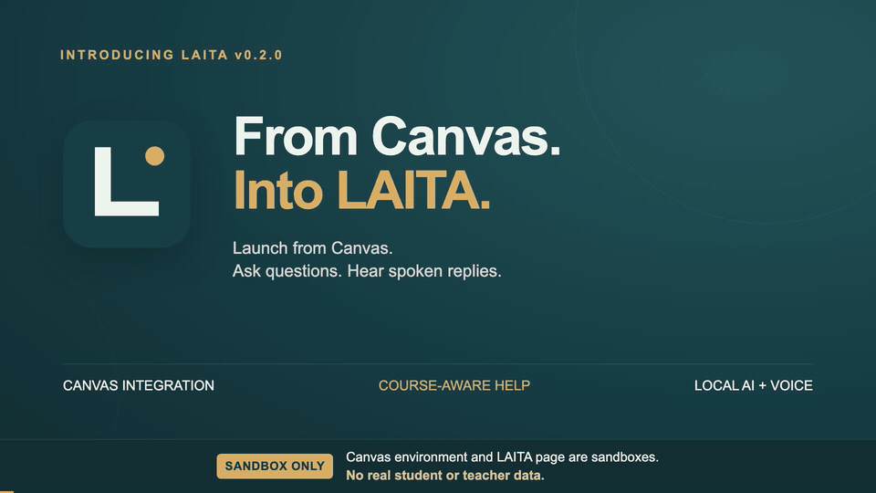

# LAITA — Local AI Teaching Assistant

**Local-first AI for course-grounded questions and instructor-controlled teaching workflows.** LAITA is independent, self-managed faculty-led software—not an official JMU service.

**Release status:** Public **v0.3.0 code candidate**, source commit `0a888602c9ea237ca0156948121fee07edaad479` (November 22, 2026). **No v0.3.0 release/tag is claimed.** The last issued release remains [v0.2.0](docs/RELEASE-NOTES-v0.2.0.md). [Candidate v0.3.0 notes](docs/RELEASE-NOTES-v0.3.0.md).

LAITA runs on a machine and local model **you** manage. Standalone use needs no Canvas, GitHub practice token, MongoDB account or OpenAI key. Optional integrations are enabled separately and must use only your own authorized, non-sensitive data. No central school servers or SSO are provided.

## Start here

| I want to… | Read |
| --- | --- |
| Install Node, Ollama, the reference HTTPS edge, and launch LAITA | [Getting Started](docs/GETTING-STARTED.md) |
| Initialize Admin / Demo Teacher / Demo Student and assign courses | [Accounts and course grants](docs/GETTING-STARTED.md#initialize-accounts-and-course-access) |
| Connect an authorized Canvas course using External App / Paste XML | [Canvas configuration](docs/CANVAS.md) |
| Generate teaching content and create a Page, Assignment or Module | [Teacher workflows](docs/TEACHING-WORKFLOW.md) |
| Verify practice submissions with bounded read-only GitHub/MongoDB checks | [Assignment verification](docs/CANVAS-VERIFICATION.md) |
| Reproduce the six teaching scenarios | [Workflow guide](docs/DEMO.md) |
| Check setup errors or file a safe GitHub Issue | [Troubleshooting and support](docs/SUPPORT.md) |
| Review the code candidate's tests and limitations | [Validation](docs/VALIDATION.md) |

## Public v0.3.0 capabilities

- **Local and grounded Chat.** Explicitly select installed Ollama models, ask follow-ups and inspect bounded public course-source evidence. Missing/ambiguous evidence is not silently fabricated. Optional OpenAI/Compare requires your own API access, explicit selection and charges.
- **Scoped practice roles.** One Admin/Owner plus *separately authenticated* Demo Teacher and Demo Student accounts. Admin manages account labels/status, sessions and IA340/IA342 course grants. An installed copy is **single-operator**; these are not real enrolled users.
- **Teacher Chat and History.** General chat, permitted Canvas tools and scoped Demo Student History Count/Summary can be selected in the same authorized course context. A fresh install starts with zero questions.
- **Editable AI teaching drafts.** Teacher Generate uses supported public course sources, exposes the source details and produces text the Teacher can edit. Model-generated drafts do not write to Canvas.
- **Optional Canvas LTI + authoring.** An appropriately mapped, signed **Instructor or Learner** course-level LTI 1.1 launch uses its own launch credentials; Canvas **REST writes require a separate Instructor token**. A Teacher can refresh and choose the destination Assignment Group; preview/confirm/create an *Unpublished* Page, Assignment or Module; refresh already saved Pages/Assignments/Modules, choose and order resources and append them to an **Unpublished** Module. A single opt-in REST setting enables this dynamic workflow without copying newly created object IDs into JSON. Teachers later publish in Canvas itself.
- **Read-only practice verification and optional feedback.** Current Canvas submission versions are previewed before selected/batch GitHub/MongoDB checks. Bounded observations are not grades or proof of authorship. Posting Test Student feedback is a separate explicit confirm/readback action.
- **Mobile web/PWA.** Responsive browser with online Safari home-screen option when your phone can reach and trust the self-managed HTTPS origin. The supplied loopback-only reference is **not** a remote-host deployment.

## See the workflows

The [six walkthroughs](docs/DEMO.md) cover Admin, Student, Teacher Chat, Teacher Generate, Teacher Verify and mobile/PWA. The image below is **an earlier v0.2.0 synthetic sandbox demonstration**, not a capture of the v0.3.0 Public code candidate:

The Owner-supplied **six DEV GIFs** are being assessed against the final Public code and privacy/media rules. They are **not yet represented as Public-build screenshots**; see [media provenance](docs/SCREENSHOTS.md). A synthetic Chromium run or DEV Sandbox recording is not real Public Canvas/device acceptance.

## Limitations, privacy and support

The reference setup is Apple Silicon macOS, Node 24/npm 11, Ollama, an operator-owned loopback HTTPS entry and locally stored SQLite. Course grounding uses explicitly supported public IA340/IA342 mappings, not arbitrary RAG, private course repos or institutional LMS data. Optional Canvas, Github/MongoDB and OpenAI connections need the appropriate rights and may be unavailable under your organization’s policies. Keep all Canvas secrets, student-related records and practice URIs out of public bug reports. Protect your own host and backup; retained text History has no automatic purge.

This source candidate has not been accepted on physical devices or against arbitrary real Canvas, Atlas, GitHub or school installations. See [validation](docs/VALIDATION.md) and [security](SECURITY.md).

## Author and community

Created and maintained by **Xuebin Wei, Ph.D.**, Associate Professor at James Madison University. [Project background](docs/ABOUT.md). LAITA software is [MIT licensed](LICENSE); media, datasets, dependencies and model weights retain their respective terms in [THIRD_PARTY.md](THIRD_PARTY.md).

Report reproducible, **redacted** bugs via [GitHub Issues](https://github.com/xbwei/local-ai-teaching-assistant/issues/new), not by submitting tokens, MongoDB URIs, student PII or private Canvas content. [Support checklist](docs/SUPPORT.md).
