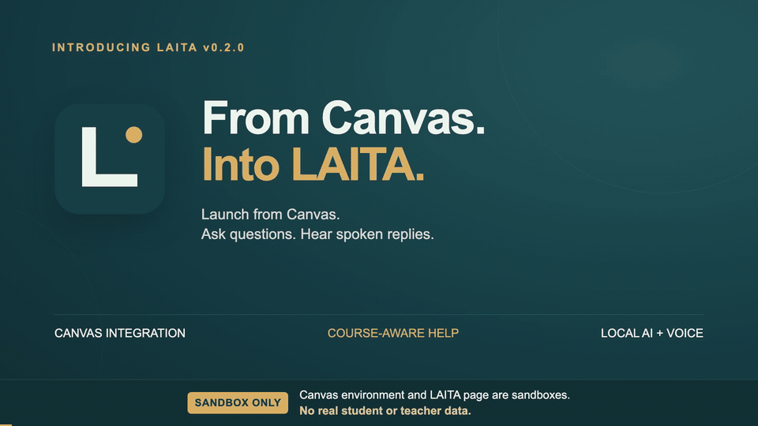

# LAITA — Local AI Teaching Assistant

A teaching assistant that runs locally, keeps a conversation going, answers questions using public course evidence, and lets one operator review saved work. LAITA is an independent faculty-led project, not an official James Madison University service or product.

**LAITA v0.2.0** · [Release notes](docs/RELEASE-NOTES-v0.2.0.md)

Public LAITA is an **individual / self-managed** installation for individual instructors and technical early adopters. You manage your own machine, local models, runtime, Owner credential and optional integrations. Core standalone use needs no school-provided server, central SSO or institution-wide provisioning. A future Enterprise offering is a separate future product/repository direction; it is not available today.

## See it in action

Owner-provided sandbox demonstration: **SANDBOX ONLY — No real student or teacher data.** [Media provenance and privacy review](docs/SCREENSHOTS.md).

## What you can do

- **Chat locally:** `gemma4:12b-mlx` by default, with an explicit `llama3.1:8b` alternative. Continue across turns, cancel a response, or start a new conversation.
- **Choose your provider:** Local / optional OpenAI / Compare, with visible provider/model attribution and no silent fallback. OpenAI uses your own key through server-side macOS Keychain.
- **Ask course-grounded questions:** supported public course sources, bounded evidence and visible source provenance. Unavailable, invalid or insufficient evidence fails closed before model invocation.
- **Review saved work:** local [History & Review](docs/HISTORY.md) at `/history`, including search, Problems, sources, feedback and operator review.
- **Use optional local speech:** the reference adapters support English/Chinese recognition and spoken replies when configured. Text answers depend on the selected model's language capability; this does not establish broader speech support.
- **Use local roles:** Owner Admin / Teacher / Student views with scoped History, all operated by the same Owner.
- **Launch from Canvas optionally:** enter the local Teacher view from one configured course; standalone use remains independent of Canvas.

## Optional Canvas course launch

Canvas is optional. Installation requires permission in your own Canvas environment to add a **course-level External App / Paste XML**; actual account and institution policies still apply. You provide the Canvas HTTPS origin, numeric course ID, numeric Canvas Owner user ID, generated consumer key, generated shared secret and exact LAITA HTTPS origin.

The consumer key/shared secret are launch credentials, not your Canvas password or a Canvas REST API token. This launch requires **no Canvas REST API token** and fetches no roster, grades, submissions or Canvas course content. Follow the full [Canvas installation guide](docs/CANVAS.md).

## Public course sources

Course grounding is separate from Canvas credentials. It uses explicitly supported public GitHub repositories (currently the two demo-course mappings), read-only public GitHub APIs and a **1 MiB per-course snapshot budget**. No GitHub token or GitHub account is needed to run standalone LAITA; neither a GitHub token nor a Canvas API token is a universal prerequisite. Anonymous API rate limits may apply. Unsupported repositories are not accepted, and unavailable, invalid or insufficient evidence fails closed. [Supported sources and limits](docs/COURSE-GROUNDING.md).

## Start with Local

Follow [Getting started](docs/GETTING-STARTED.md) for prerequisites, installation, configuration, model setup and the first conversation. The reference deployment uses an Apple Silicon Mac, Ollama, Node 24 and an operator-controlled HTTPS entry on loopback. OpenAI is optional.

| Guide                                                          | What it covers                                                                                            |
| -------------------------------------------------------------- | --------------------------------------------------------------------------------------------------------- |
| [Local roles and optional Canvas course App](docs/CANVAS.md)   | Hidden Terminal credential setup, standalone roles, signed Instructor launch, removal and troubleshooting |
| [Demo courses / Course-grounded Q&A](docs/COURSE-GROUNDING.md) | Source refresh, visible citations, evidence refusal and substituting supported public course material     |
| [OpenAI / Compare](docs/OPENAI.md)                             | Cloud data flow, interactive Keychain setup, enabling, missing credentials, rotation and deletion         |
| [History & Review](docs/HISTORY.md)                            | Retained records, feedback, operator review and access limitations                                        |
| [Speech and Pi client](docs/SPEECH.md)                         | English/Chinese reference support, local adapters and hardware acceptance                                 |
| [Deployment](docs/DEPLOYMENT.md)                               | Operator-owned macOS lifecycle, hardware photos, HTTPS and recovery                                       |

## Privacy and current limits

Local inference and course evidence remain on your host. Optional OpenAI sends eligible general questions and bounded provider-specific context to OpenAI; course excerpts and archived History are not sent. Text history persists locally; microphone and generated audio are temporary. See [data flow](docs/ARCHITECTURE.md) and [security policy](SECURITY.md).

LAITA remains **single-operator**: one Owner operates local Admin / Teacher / Student roles using an initialized passphrase, with scoped sessions and History. Optional Canvas admits only the configured Instructor into Teacher. These are not real participant accounts; the reference entry stays on loopback. There is one admitted operation with no queue, bounded context/retrieval, and two explicit public demo-course mappings. It is not a student account, LMS or grading platform. Live model quality, Cloud account availability, real speech quality and physical hardware acceptance are not established by synthetic tests. [Validation and limitations](docs/VALIDATION.md).

## Author, support and community

Created and maintained by **Xuebin Wei, Ph.D.**, Associate Professor in JMU's Intelligence Analysis program. [Verified professional profile and project background](docs/ABOUT.md).

Thank you to JMU's School of Integrated Sciences and College of Integrated Science and Engineering, including CISE Faculty Mini-Grant and Educational Leave support. Additional support was provided by OpenAI through ChatGPT for Academic Researchers. These acknowledgments do not imply endorsement by JMU or OpenAI. [Official names and acknowledgments](docs/ABOUT.md#acknowledgments).

Bug reports and focused feature requests are welcome through [GitHub Issues](https://github.com/xbwei/local-ai-teaching-assistant/issues). Use a minimal, non-sensitive reproduction. [Contributing](CONTRIBUTING.md) · [Validation & limitations](docs/VALIDATION.md).

LAITA-authored software is under the [MIT License](LICENSE). Models, course content, dependencies and recorded media retain their own rights; see [third-party boundaries](THIRD_PARTY.md).
