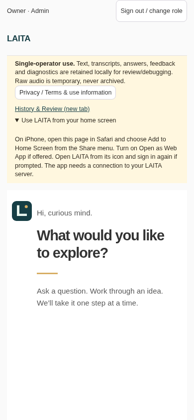

# LAITA — Local AI Teaching Assistant

A teaching assistant that runs locally, keeps a conversation going, answers questions using public course evidence, and lets one operator review saved work. LAITA is an independent faculty-led project, not an official James Madison University service or product.

**v0.3.0 release track** · [Release notes](docs/RELEASE-NOTES-v0.3.0.md) · [Published releases](https://github.com/xbwei/local-ai-teaching-assistant/releases)

Public LAITA is an **individual / self-managed** installation for individual instructors and technical early adopters. You manage your own machine, local models, runtime, Owner credential and optional integrations. Core standalone use needs no school-provided server, central SSO or institution-wide provisioning. A future Enterprise offering is a separate future product/repository direction; it is not available today.

## See it in action

  
  

Public UI, captured in Chromium with synthetic inputs and responses. These images illustrate the online phone interface; they are not a physical-device acceptance result. [Six public workflows](docs/DEMO.md) · [Media provenance](docs/SCREENSHOTS.md).

### What is new in v0.3.0

| Workflow                      | What the public app provides                                                                                                                      |
| ----------------------------- | ------------------------------------------------------------------------------------------------------------------------------------------------- |
| Phone access                  | A responsive online interface and an optional Safari home-screen entry.                                                                           |
| Local Teacher tools           | Editable, course-grounded lesson and assignment drafts; a separate History plugin for one configured Test Student sample.                         |
| Canvas authoring              | Preview, confirm and check unpublished Pages, Assignments and Modules; rename an approved Assignment or append one approved resource to a Module. |
| Canvas questions and feedback | Read-only Count/Score questions and an explicitly confirmed plain-text comment for the configured Test Student.                                   |
| Practice verification         | Bounded read-only GitHub and MongoDB checks for each configured student's current Canvas attempt.                                                 |
| Local support                 | Retained History and a metadata-only diagnostic lookup for the local Admin.                                                                       |

These workflows retain the single-Owner installation model. Canvas and the verifiers are optional; [start with standalone Local](docs/GETTING-STARTED.md).

## What you can do

- **Chat locally:** `gemma4:12b-mlx` by default, with an explicit `llama3.1:8b` alternative. Continue across turns, cancel a response, or start a new conversation.
- **Choose your provider:** Local / optional OpenAI / Compare, with visible provider/model attribution and no silent fallback. OpenAI uses your own key through server-side macOS Keychain.
- **Ask course-grounded questions:** supported public course sources, bounded evidence and visible source provenance. Unavailable, invalid or insufficient evidence fails closed before model invocation.
- **Use LAITA on a phone:** the responsive interface supports an online Safari home-screen entry when your phone can reach your LAITA HTTPS origin. [Phone setup](docs/GETTING-STARTED.md#iphone-home-screen-entry).
- **Draft teaching material:** use the [standalone Teacher tools](docs/TEACHING-WORKFLOW.md) for Local lesson and assignment drafts grounded in supported course sources.
- **Ask about practice questions:** the opt-in [History Chat plugin](docs/HISTORY.md#teacher-history-plugin) counts and locally summarizes one Test Student sample.
- **Check a Canvas sample:** the optional [Canvas Chat plugin](docs/CANVAS.md#canvas-chat-plugin) answers read-only submission and score questions for one approved assignment and the course’s configured Test Student.
- **Verify practice submissions:** the optional [GitHub and MongoDB verifiers](docs/CANVAS-VERIFICATION.md) check a configured course roster and show bounded observations per current attempt.
- **Post Canvas feedback:** preview and explicitly post one [plain-text comment](docs/CANVAS.md#canvas-teacher-feedback) to the configured Canvas Test Student’s supported submission.
- **Review saved work:** local [History & Review](docs/HISTORY.md) at `/history`, including search, Problems, sources, feedback and operator review. Admin can [look up a retained turn by correlation reference](docs/HISTORY.md#admin-diagnostic-lookup).
- **Use optional local speech:** the reference adapters support English/Chinese recognition and spoken replies when configured. Text answers depend on the selected model's language capability; this does not establish broader speech support.
- **Use local roles:** Owner Admin / Teacher / Student views with scoped History, all operated by the same Owner.
- **Optional Canvas Teacher authoring:** launch from one configured course. With separate REST access, preview and explicitly create unpublished Pages, Assignments and Modules, rename an approved Assignment, or add an approved Page or Assignment to an unpublished Module. LAITA checks the result in Canvas.

## Optional Canvas course launch

Canvas is optional. Installation requires permission in your own Canvas environment to add a **course-level External App / Paste XML**; actual account and institution policies still apply. You provide the Canvas HTTPS origin, numeric course ID, numeric Canvas Owner user ID, generated consumer key, generated shared secret and exact LAITA HTTPS origin.

The consumer key/shared secret are launch credentials, not your Canvas password or a Canvas REST API token. The signed launch requires **no Canvas REST API token**. The optional Canvas authoring panels use a backend token for the same Instructor and course. They recheck the target before an explicit write and report the readback result. Standalone use needs neither configuration. [Canvas installation and authoring](docs/CANVAS.md)

## Public course sources

Course grounding is separate from Canvas credentials. It uses explicitly supported public GitHub repositories (currently the two demo-course mappings), read-only public GitHub APIs and a **1 MiB per-course snapshot budget**. No GitHub token or GitHub account is needed to run standalone LAITA; neither a GitHub token nor a Canvas API token is a universal prerequisite. Anonymous API rate limits may apply. Unsupported repositories are not accepted, and unavailable, invalid or insufficient evidence fails closed. [Supported sources and limits](docs/COURSE-GROUNDING.md).

## Start with Local

Follow [Getting started](docs/GETTING-STARTED.md) for prerequisites, installation, configuration, model setup and the first conversation. The reference deployment uses an Apple Silicon Mac, Ollama, Node 24 and an operator-controlled HTTPS entry on loopback. OpenAI is optional.

[The v0.3.0 notes](docs/RELEASE-NOTES-v0.3.0.md) describe the changes since v0.2.0, upgrade and recovery, and the distinction between synthetic validation and live acceptance.

| Guide                                                          | What it covers                                                                                                              |
| -------------------------------------------------------------- | --------------------------------------------------------------------------------------------------------------------------- |
| [Local roles and optional Canvas tools](docs/CANVAS.md)        | Owner role setup, signed Instructor launch, Pages, Assignments, Modules, Canvas Chat, feedback, removal and troubleshooting |
| [Local Teacher workflow](docs/TEACHING-WORKFLOW.md)            | Course-grounded lesson and assignment drafts, editable Markdown and the Test Student History sample                         |
| [GitHub and MongoDB verification](docs/CANVAS-VERIFICATION.md) | Explicit practice targets, Canvas user IDs, read-only observations, naming limits and unknown/partial results               |
| [Public workflow tour](docs/DEMO.md)                           | Six public workflows, accurate phone captures and the scope of each optional tool                                           |
| [Demo courses / Course-grounded Q&A](docs/COURSE-GROUNDING.md) | Source refresh, visible citations, evidence refusal and substituting supported public course material                       |
| [OpenAI / Compare](docs/OPENAI.md)                             | Cloud data flow, interactive Keychain setup, enabling, missing credentials, rotation and deletion                           |
| [History & Review](docs/HISTORY.md)                            | Retained records, feedback, operator review and access limitations                                                          |
| [Speech and Pi client](docs/SPEECH.md)                         | English/Chinese reference support, local adapters and hardware acceptance                                                   |
| [Deployment](docs/DEPLOYMENT.md)                               | Operator-owned macOS lifecycle, hardware photos, HTTPS and recovery                                                         |

## Privacy and current limits

Local inference and course evidence remain on your host. Optional OpenAI sends eligible general questions and bounded provider-specific context to OpenAI; course excerpts and archived History are not sent. Text history persists locally; microphone and generated audio are temporary. See [data flow](docs/ARCHITECTURE.md) and [security policy](SECURITY.md).

LAITA remains **single-operator**: one Owner operates local Admin / Teacher / Student roles using an initialized passphrase, with scoped sessions and History. Optional Canvas admits only the configured Instructor into Teacher. These are not real participant accounts; the reference entry stays on loopback. There is one admitted operation with no queue, bounded context/retrieval, and two explicit public demo-course mappings. It is not a student account, LMS or grading platform. Live model quality, Cloud account availability, real speech quality and physical hardware acceptance are not established by synthetic tests. [Validation and limitations](docs/VALIDATION.md).

## Author, support and community

Created and maintained by **Xuebin Wei, Ph.D.**, Associate Professor in JMU's Intelligence Analysis program. [Verified professional profile and project background](docs/ABOUT.md).

Thank you to JMU's School of Integrated Sciences and College of Integrated Science and Engineering, including CISE Faculty Mini-Grant and Educational Leave support. Additional support was provided by OpenAI through ChatGPT for Academic Researchers. These acknowledgments do not imply endorsement by JMU or OpenAI. [Official names and acknowledgments](docs/ABOUT.md#acknowledgments).

Bug reports and focused feature requests are welcome through [GitHub Issues](https://github.com/xbwei/local-ai-teaching-assistant/issues). Use a minimal, non-sensitive reproduction. [Contributing](CONTRIBUTING.md) · [Validation & limitations](docs/VALIDATION.md).

LAITA-authored software is under the [MIT License](LICENSE). Models, course content, dependencies and recorded media retain their own rights; see [third-party boundaries](THIRD_PARTY.md).
