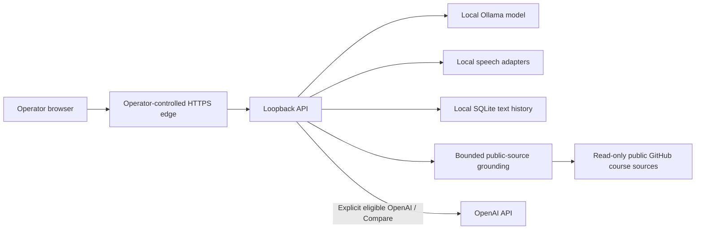

# Architecture

LAITA has eleven npm workspaces and one loopback API serving the built browser UI. A trusted operator-controlled HTTPS edge supplies transport protection. The API verifies one local Owner/Admin credential plus separately initialized practice Teacher and Student credentials, applies SQLite-backed course grants, and issues role/course-scoped HttpOnly browser sessions. Each page retains its own transient conversation reference, bound to its authenticated session. History uses the existing store with role/context restrictions; local Admin alone can review pre-v0.2 unscoped records. The API admits one operation with no queue and coordinates policy, providers, grounding, speech and the existing local SQLite store. See the checked [module graph](MODULES.md).

Local Ollama runs on loopback with one primary model resident; explicit switching and failures are visible. Optional OpenAI calls use a server-only Keychain secret handle, bounded eligible active context and `store: false`. There is no provider/model fallback. Compare uses independent legs and provider-specific previous answers.

Public course GitHub fetches are read-only and unauthenticated. Bounded Markdown snapshots remain local. Query-triggered freshness is checked after 24 hours; refresh/source validation failures remain visible. Only the Local grounded leg receives evidence. No vector database or new persistent store exists.

The local store retains text/transcripts/answers, sources, provider/model identity, execution diagnostics, feedback and review state. Opening History does not invoke providers. Temporary recording/synthesis files are cleaned on their documented job/session lifecycle; they are not archived in history. Local logs use allowlisted event metadata rather than raw conversation or secrets.

## Data flow

The browser never receives an OpenAI key. Public-source refresh requests go to GitHub; downloaded Markdown snapshots stay in your local runtime directory. Grounded course requests use Local only; OpenAI/Compare does not receive course excerpts. Eligible general OpenAI requests send bounded active non-sensitive questions and that provider's prior answers. The Responses adapter requests `store: false`; OpenAI's own service/data policies still apply. Browsing archived History calls neither provider. [Architecture and boundaries](ARCHITECTURE.md).

## Optional signed Canvas entry and bounded Teacher tools

The latest Public v0.3.0 code candidate retains the **single-operator, self-managed** architecture while adding separately authenticated Demo Teacher and Demo Student practice accounts and permitted IA340/IA342 course memberships. The stopped-run setup initializes Admin and the practice credentials independently. SQLite holds credential verifiers, membership/authorization revisions and launch replay evidence; transient browser sessions remain tied to active role, principal and course. Expired, revoked, disabled or cross-course requests are refused. This is **not** a generic user sign-up system, institutional roster sync or campus SSO.

The optional **course-level LTI 1.1** form POST is verified with OAuth HMAC-SHA1 against the configured canonical launch URL, exact Canvas HTTP Origin, signed course/user/role, consumer key, bounded timestamp and one-time nonce. An authorized **Instructor** maps to Teacher; an authorized **Learner** maps to Student only under the supported course/identity binding. Neither receives Admin privileges. The recoverable LTI shared secret is stored in a protected operator-only external configuration file, not in browser storage, Git or the application JSON.

**Canvas REST access is a separate authority.** It requires an optional operator-owned, time-limited token for the exact signed Instructor/course and is unavailable through a Learner session or LTI credentials alone. With sufficient REST permissions, the Teacher can read the current course's Assignment Groups, choose one explicitly, preview/confirm and read back an Unpublished Assignment or Page. The optional `organizeSavedResources` scope reads the current course's saved Pages/Assignments/Modules and, after Teacher preview/confirmation, appends selected resources to an **Unpublished** Module. The AI drafts text, not destinations, and does not publish. Verification and separately confirmed Test Student feedback have distinct provider/scope restrictions. Unknown write outcomes require a Canvas inspection rather than automatic retry.

This code path has synthetic fixture/browser verification, **not live Canvas or physical-device acceptance**. The included reference HTTPS/Caddy configuration still binds to loopback; a separately protected remote/phone entry requires explicit operator setup. [Install and scope](CANVAS.md) · [Validation and NOT_RUN](VALIDATION.md).
