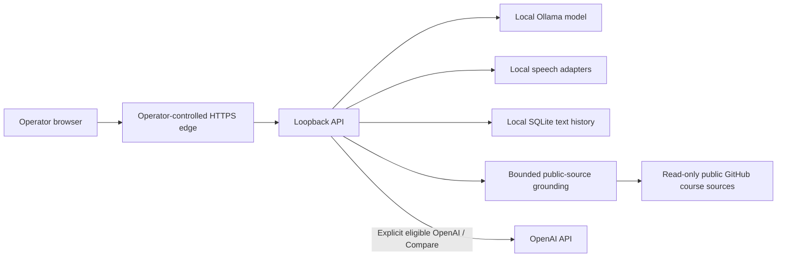

# Architecture

LAITA has eleven npm workspaces and one loopback API serving the built browser UI. A trusted operator-controlled HTTPS edge supplies transport protection. The API owns local single-Owner credential verification and HttpOnly browser role sessions. Each page retains its own transient conversation reference, bound to its authenticated session. History uses the existing store with role/context restrictions; local Admin alone can review pre-v0.2 unscoped records. The API admits one operation with no queue and coordinates policy, providers, grounding, speech and the existing local SQLite store. See the checked [module graph](MODULES.md).

Local Ollama runs on loopback with one primary model resident; explicit switching and failures are visible. Optional OpenAI calls use a server-only Keychain secret handle, bounded eligible active context and `store: false`. There is no provider/model fallback. Compare uses independent legs and provider-specific previous answers.

Public course GitHub fetches are read-only and unauthenticated. Bounded Markdown snapshots remain local. Query-triggered freshness is checked after 24 hours; refresh/source validation failures remain visible. Only the Local grounded leg receives evidence. No vector database or new persistent store exists.

The local store retains text/transcripts/answers, sources, provider/model identity, execution diagnostics, feedback and review state. Opening History does not invoke providers. Temporary recording/synthesis files are cleaned on their documented job/session lifecycle; they are not archived in history. Local logs use allowlisted event metadata rather than raw conversation or secrets.

## Data flow

The browser never receives an OpenAI key. Public-source refresh requests go to GitHub; downloaded Markdown snapshots stay in your local runtime directory. Grounded course requests use Local only; OpenAI/Compare does not receive course excerpts. Eligible general OpenAI requests send bounded active non-sensitive questions and that provider's prior answers. The Responses adapter requests `store: false`; OpenAI's own service/data policies still apply. Browsing archived History calls neither provider. [Architecture and boundaries](ARCHITECTURE.md).

## Optional signed Canvas entry

The v0.2.0 candidate adds no application, database or authentication framework. One Owner credential (salted scrypt N=131072/r=8/p=1) initializes standalone Admin/Teacher/Student access. A bounded in-memory session map stores only token digests, role, credential revision, expiry and optional Canvas context/config fingerprint. API restart clears browser sessions; credential revision changes invalidate them. Existing input sessions bind to that authenticated session plus the transient client reference, preserving page isolation and global admission.

The optional course-level LTI 1.1 form POST is authenticated using OAuth HMAC-SHA1 and the configured canonical launch URL. It requires the exact Canvas HTTP Origin, signed Canvas domain/course/user substitutions, Instructor role, consumer key, ±300-second timestamp and an atomic previously unused nonce in the same SQLite database. Only Teacher is issued. A stable origin/course/identity digest scopes Canvas History; a separate credential/config fingerprint invalidates sessions on configuration rotation/removal. No profiles, enrollment/membership tables or Canvas REST calls exist. Standalone Teacher can inspect its own Canvas records; Student remains separate and Admin can inspect all retained Owner History.

The shared secret must remain recoverable for HMAC and is read from one optional owner-only external JSON file; passphrases are never stored there. Missing/unsafe/disabled configuration disables Canvas without blocking standalone. Top-level navigation avoids third-party cookie/iframe support; framing remains disabled. [Setup and explicit limits](CANVAS.md).
