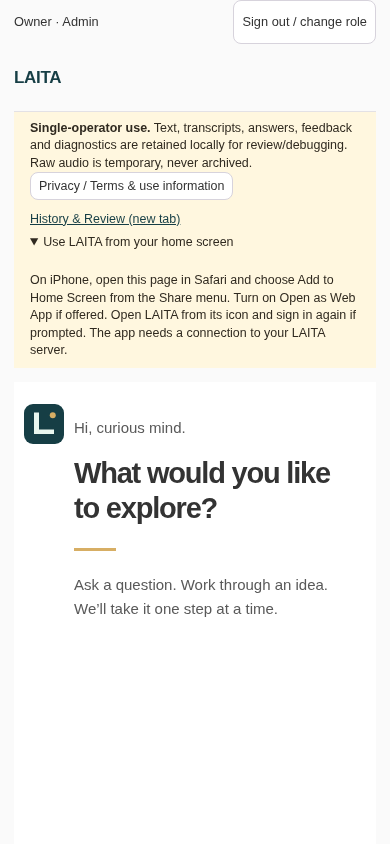
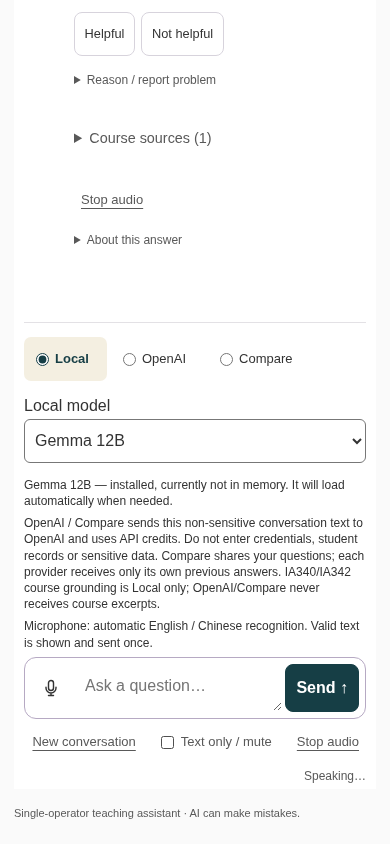
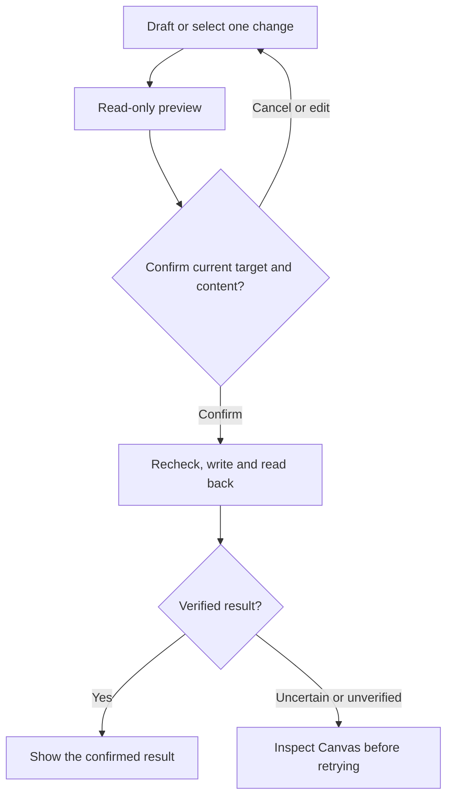

# Six public LAITA workflows

This tour describes the public v0.3.0 release track. Start with [a self-managed Local installation](GETTING-STARTED.md); one Owner operates its Admin, Teacher and Student views. Optional Canvas tools require their documented setup and permissions.

The phone images below are existing synthetic Chromium captures of the public UI. The diagrams describe workflows and are not recordings of live integrations. [Media provenance](SCREENSHOTS.md) · [Release notes](RELEASE-NOTES-v0.3.0.md).

## 1. Ask a course-grounded question

Choose a supported public course and ask one focused question, such as “What must I submit for IA342's fifth assignment?” Review the answer's repository, revision, path, section and excerpt. Missing or insufficient evidence produces a refusal or unavailable result before a model is invoked.

General chat supports an explicit Local / optional OpenAI / Compare choice. Course-grounded requests remain Local. [Course sources and limits](COURSE-GROUNDING.md) · [Cloud data flow](OPENAI.md).

## 2. Open the same host from a phone

  
  

The interface adapts to a compact screen and offers Safari home-screen instructions. Your phone must reach the configured, trusted HTTPS origin. This is an online client of your host, not an offline model running on the phone. These captures do not establish native Safari or physical-device acceptance. [Phone setup](GETTING-STARTED.md#iphone-home-screen-entry).

## 3. Draft and revise teaching material locally

Sign in to standalone Teacher, open **Local teaching drafts**, choose a supported course and draft type, and enter a topic. Generate with Local, inspect the sources, and revise the editable Markdown. A generated draft does not write to Canvas.

The separate **History Chat plugin** counts or locally summarizes one configured Test Student sample. It does not expose a class roster's private conversations. [Teacher workflow](TEACHING-WORKFLOW.md) · [History sample](HISTORY.md#teacher-history-plugin).

## 4. Preview a Canvas change before applying it

Signed Instructor launch opens the configured Teacher context. With separate REST configuration, use the individual Page, Assignment or Module panel. Create an unpublished item, rename an approved Assignment, or append one approved resource to an unpublished Module.

Modules are created empty; each append operation adds one approved Page or Assignment. The public app does not offer the broader multi-resource module editor shown by some development demonstrations. [Canvas authoring](CANVAS.md).

## 5. Check a configured sample and post reviewed feedback

The **Canvas Chat plugin** answers Count or Score questions by full assignment title for its configured Canvas Test Student. It uses a separate panel from standalone Teacher's local History plugin.

For feedback, review the current supported Test Student submission, prepare one plain-text comment, preview it and explicitly post it. LAITA reports a readback result. This workflow does not change grades or automatically retry an uncertain write. [Canvas Chat](CANVAS.md#canvas-chat-plugin) · [Feedback](CANVAS.md#canvas-teacher-feedback).

## 6. Verify practice work and inspect bounded results

Configure the course, assignment and each permitted student's **Canvas user ID**, then select GitHub or MongoDB in **Verify Canvas submissions**. The browser checks one current attempt at a time and supports cancellation.

| Result                | How to interpret it                                                                                    |
| --------------------- | ------------------------------------------------------------------------------------------------------ |
| Observed              | The configured checks produced observations for the displayed attempt. A resource can still be absent. |
| Partial               | A limit or incomplete provider response prevents a complete observation.                               |
| Unknown               | A submission or provider is unavailable, or the attempt changed.                                       |
| Unchecked / cancelled | No completed observation is available for that row.                                                    |

GitHub checks approved account/repository/path and optional pull-request metadata. MongoDB performs fixed read-only metadata and aggregate checks. Public results expose bounded status values, not credentials, document contents, collection/field names or exact document counts. Neither verifier grades work, proves authorship or posts feedback. [Verification setup](CANVAS-VERIFICATION.md).

For local troubleshooting, the Owner can review retained History and use Admin's correlation-reference lookup for bounded stage metadata. This is not multi-user account administration. [Admin diagnostics](HISTORY.md#admin-diagnostic-lookup).

## What the tour establishes

These examples explain the public product's scope. They do not establish measured learning gains, answer accuracy, real-provider acceptance or a deployed service for students. The [validation guide](VALIDATION.md) separates synthetic software checks from live environment acceptance. Historical and development demonstrations retain their own version context; [provenance](SCREENSHOTS.md) is part of using them accurately.
