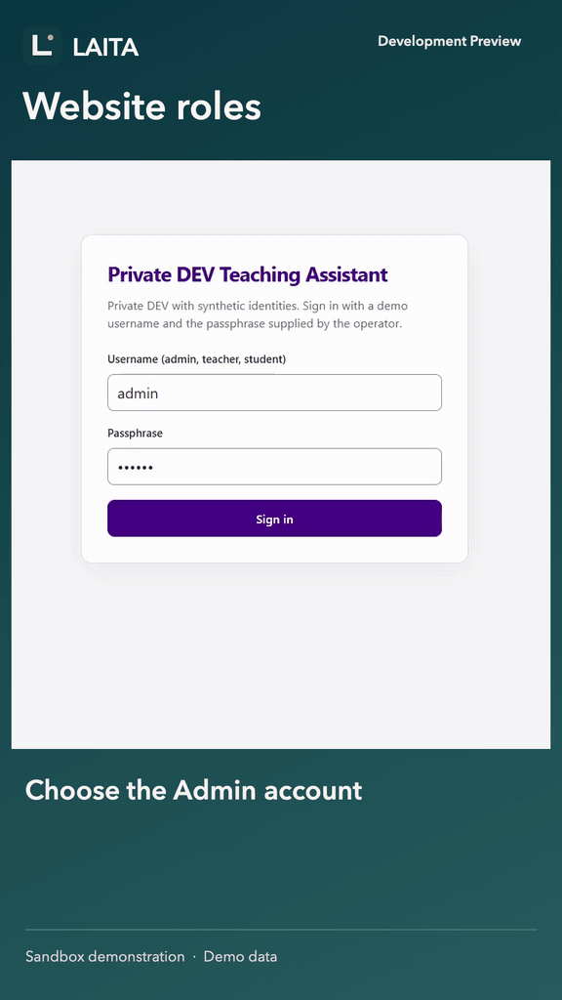
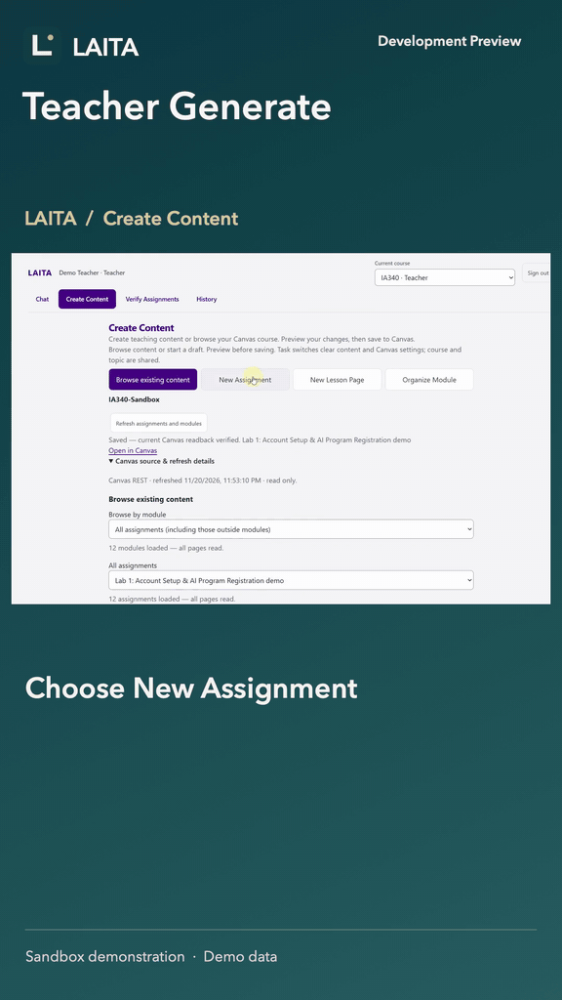
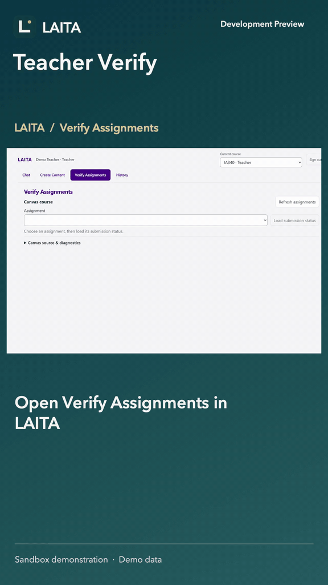
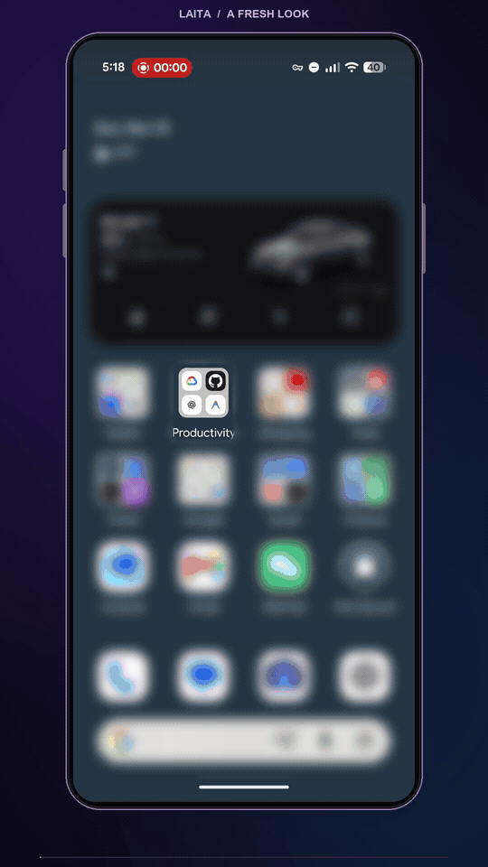

# Six LAITA workflows — reproducible v0.3.0 release walkthroughs

These are **Public v0.3.0 source-code workflows** for one self-managed operator, anchored to the [published v0.3.0 release](https://github.com/xbwei/local-ai-teaching-assistant/releases/tag/v0.3.0), commit `ed4b9c221ea2ebcc01c8ce1db32a35a69ccfb4a8`. They are not evidence of live Canvas or real student acceptance. Use only your own synthetic/non-sensitive sample data. See [installation](GETTING-STARTED.md), [Canvas setup](CANVAS.md) and [validation](VALIDATION.md).

**Complete DEV walkthrough:** [Watch the full LAITA v0.3.0 demo on YouTube](https://youtu.be/C6K6ukVqtu4) (unlisted). This is additional synthetic development footage, not the exact Public release or a real institutional Canvas/student-data demonstration. Follow the steps below for the supported released behavior.

The six Owner-provided **DEV** animated previews are embedded below with explicit sandbox provenance. They are *illustrations of the comparable user journeys*, not exact UI captures or live Canvas/device acceptance for this Public source commit. The Admin clip shows some DEV-only account capabilities; the Public version remains single-Owner and narrower. The Generate and Mobile clips are excerpts, not complete recordings. The older [v0.2.0 Canvas sandbox GIF](assets/demo/laita-v020-canvas.gif) is retained only as historical release media. [Source and media review notes](SCREENSHOTS.md).

## 1. Admin — identities and course grants

**Preview caveat:** the DEV Administration screen includes broader course-role/delegated-Admin controls than the released Public version. Reproduce the *Public* behavior using the account and grant instructions below, not every button in the clip.

Initialize Owner/Admin with `npm run owner:setup` and the two practice accounts with `npm run demo:setup -- IA340`. Sign in as Admin using its **distinct** passphrase, inspect the fixed Demo Teacher/Student accounts, and grant or revoke a supported course. Sign in separately as each practice account; only currently authorized courses should be available. An Account disable or grant revocation invalidates the relevant session.

## 2. Student — source-grounded questions and local History

[Full-size source-answer still](assets/screenshots/v030-dev/02h-Complete-course-answer.png) — Owner-provided DEV sandbox capture, not a Public exact-build test.

Sign in as Demo Student. Ask what a specific IA342 assignment requires, open the source path/section in the reply and check the versioned public course instructions; ask a follow-up. Its History starts empty and grows only after actual practice turns. Signed **Canvas Learner** launch, if desired, must be tested with a genuinely authorized Learner account; a Canvas Student View Test Student is not an LTI launch substitute.

## 3. Teacher Chat — General / Canvas / History

**Scope:** the displayed Canvas submission/score is for a configured Test Student, not an entire class.

Choose an authorized course with Demo Teacher and switch the Chat tool to General or History. After a practice Student asks some questions, ask History for count and bounded summary in the same course; in an empty course, expect zero/empty. Optional Canvas Chat requires a separately configured, signed Instructor launch and REST access to the exact approved Test Student/assignment scope. Never infer class totals from a single Test Student.

## 4. Teacher Generate — create and organize content

The GIF is a **short excerpt**. See the [editable AI draft](assets/screenshots/v030-dev/04d-Generated-assignment-suggestion.png) and the [resulting Canvas Module with Page and Assignment](assets/screenshots/v030-dev/04k-Canvas-module-with-ordered-items.png). These are DEV-origin illustrations. In released Public v0.3.0, the steps are separate create → refresh saved resources → Preview/Confirm, with Unpublished results.

With the configured local model and supported public course snapshot, generate a Page/Assignment suggestion, inspect the cited material, edit and explicitly apply it. In a signed Canvas Teacher session with a **separate authorized REST token**, refresh **Assignment Groups** and choose the destination yourself. Preview and confirm creation of an **Unpublished Assignment**; similarly create an Unpublished Page. Create an Unpublished Module by name. Enable the documented dynamic organizer **once**, click **Refresh saved Canvas resources**, select the new Page/Assignment and new Module directly in the UI, order the selected items, preview, confirm and check readback. **No copying object IDs to JSON** after creation. The teacher publishes later in Canvas.

## 5. Teacher Verify — current practice submissions

[Example of bounded MongoDB observations](assets/screenshots/v030-dev/05e-MongoDB-count-and-sampled-fields.png), showing the **configured Test Student** and sampled fields, not proof of student authorship or a grade.

Configure the approved non-sensitive practice student and assignment/provider targets. Preview the selected/batch current Canvas attempt and submission version, confirm, run bounded read-only GitHub or MongoDB checks and inspect Observed/Partial/Unknown statuses. If the submission changes, preview it again. This is not grading or proof of authorship.

## 6. Mobile / PWA — the same scoped service

This is an **excerpt** from the Owner's phone recording, not a native Safari acceptance test of the current Public SHA.

Reach an **operator-protected HTTPS origin** on your phone; the bundled `localhost` Caddy example does not work from a different physical device. In Safari use **Share → Add to Home Screen** if available. Log in to the appropriate practice role and try a safe Chat/Teacher workflow. Requires connection and valid course access. A synthetic Chromium phone-size scenario does not prove native iPhone/Android acceptance.

## Evidence to retain

For a reproducible report, note the Public tag/SHA, OS/Node/npm and model tag, synthetic role/course and exact step, and observed result. Label API/browser fixtures vs. live-provider/device acceptance distinctly. Do **not** attach real school names, student records, credentials or private Canvas/GitHub/MongoDB data. [Safe GitHub issue guidance](SUPPORT.md).
