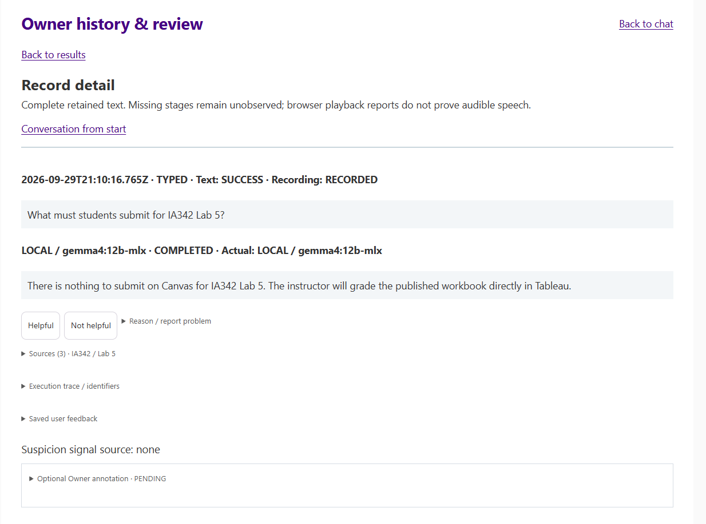

# Local History & Review

Open `/history` through the same protected operator HTTPS entry. All records and Problems views support search/filter and source/provider/model/execution inspection. Feedback and operator review are local writes. Problems include recorded failures, incomplete capture, reports, Not helpful feedback, suspicion signals and confirmed issues; pending review alone is not a failure.

The existing SQLite store retains full text questions, successful transcripts, answers, snapshot course/commit identity, citations, diagnostics, feedback and review state. Its schema migration/recovery behavior is tested with synthetic databases. Archival browsing never calls Local or Cloud. Execution detail describes recorded events, not guessed missing phases.

New conversation clears active model context, not saved history. No automatic expiry/deletion schedule or encrypted-at-rest storage is implemented. Protect your account/disk and runtime directory. Preserve the store before diagnosing capture or migration failures; do not blindly delete/recreate it to hide a problem. Raw microphone/generated audio is temporary and is not archived in the store.

This is one Owner's dashboard behind local role sign-in, not a multi-person service. Admin can inspect all retained records, including pre-v0.2 History. Teacher and Student see their respective role records. Regular Student excludes Test Student sample records. Canvas Teacher sees only its configured origin/course/identity context. Student cannot write Owner review annotations. Role/session references cannot transfer access. See [role setup and Canvas boundaries](CANVAS.md). Never expose the reference entry as a public student/admin system.

## Teacher History plugin

With LAITA stopped, set `LAITA_HISTORY_SAMPLE_ID` in the API process environment to a stable operator-chosen label of 1–32 lowercase ASCII letters, digits or hyphens beginning with a letter or digit. Restart the API with the [public operator configuration](GETTING-STARTED.md). Leaving the variable unset or using an invalid label disables the plugin. It is a local scope label. Keep the same label for the same sample, and use a separate label to start a different sample. Changing or removing it does not delete retained records.

1. Sign out, select **Student**, and check **Test Student sample (if configured)** before signing in. Confirm the role badge says **Test Student sample**. Create a few ordinary practice questions in Local Chat, such as “How can I compare two visual explanations?” Use only synthetic, non-sensitive text. This is a sample operated by the same Owner.
2. Sign out and sign in locally as **Teacher**. Open **History Chat plugin** and choose **Ask History** with “How many questions in the last seven days?”, “How many questions this week?”, or “Summarize recent questions.” “What topics did the Test Student ask about?” is also supported.
3. Check the result against the sample you created. Unsupported questions get scope guidance, and an empty window or unavailable Local model has an explicit message.

The plugin reads recorded question text from the configured local sample alone. It includes eligible typed questions and recognized transcripts already recorded there. The recent window is seven days. “This week” begins Monday at 00:00 UTC. Count reports up to 1,000 matching records and uses “at least” if that cap is exceeded. Count does not call a model. Summary considers up to 12 recent records and sends at most 2 KiB of eligible question text to the selected Local model. It omits answers, identifiers, logs, feedback, review notes, grades, usage records and Canvas data. It neither reads ordinary Student records nor combines different sample labels. A summary describes topics in this sample and may omit material. It cannot measure a course or class. Canvas-launched sessions cannot use this plugin.

The plugin accepts up to 1,024 UTF-8 bytes of generated text. It folds tabs and line breaks into spaces and checks the complete summary before displaying it. An ineligible or oversized result leaves Count available.

## Dashboard example

This Owner-provided capture shows an earlier History record-detail view for a public demo-course question: retained answer, requested/actual Local model, Sources, execution detail, feedback and operator annotation. It is an illustration, not evidence of LAITA Public V1's answer correctness or student deployment. The UI text and timestamp are preserved; no student identifiers, credentials or private host/path are visible. [Source/privacy review](SCREENSHOTS.md).

## Date filters

API `since` / `until` filters use canonical UTC timestamps with exactly three millisecond digits (`YYYY-MM-DDTHH:mm:ss.sssZ`), matching retained timestamps and SQLite text ordering. Normalize an integration's date with `Date.toISOString()` before submitting it. Invalid calendar dates and noncanonical precisions/offsets return 400 before querying storage; archived filtering never invokes a provider.
